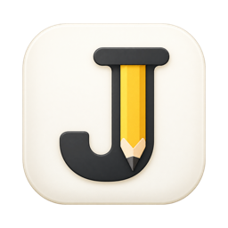
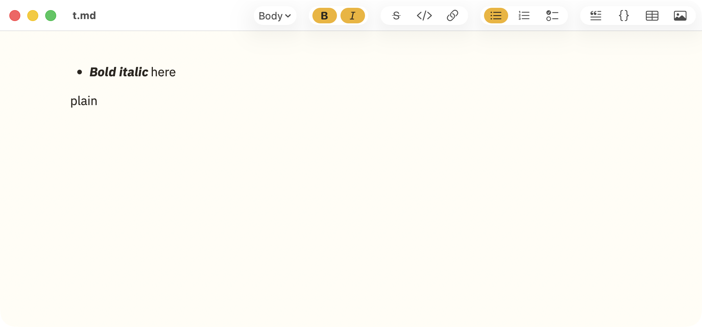

<p align="center">
  
</p>

<h1 align="center">Jotdown</h1>

<p align="center">
  A fast, lightweight Markdown editor for macOS that feels like Notion.<br>
  You see formatted text while you write, and your notes stay plain <code>.md</code> files.
</p>

<p align="center">
  
</p>

## Why Jotdown?

- **Write without seeing syntax.** Headings look like headings and bold text looks bold. You never see `#` or `**`, the same as in Notion or a word processor.
- **Your files stay yours.** Jotdown reads and writes ordinary Markdown files that any other app can open, including Obsidian, VS Code and GitHub.
- **Fast and native.** Jotdown is built with Swift and AppKit and contains no web browser. It opens instantly and handles documents with thousands of lines smoothly.
- **Never lose work.** Changes are saved about a second after you stop typing.

## Features

| | |
|---|---|
| **Text** | Bold, italic, strikethrough, inline code, links |
| **Blocks** | Headings 1–6, bulleted, numbered and checklists (nestable), quotes, code blocks, dividers |
| **Tables** | Edit cells directly, use Tab to move between cells, add and remove rows and columns, set column alignment |
| **Images** | Drag in images or paste screenshots. Images are copied into an `assets/` folder next to your note |
| **Links** | Hover a link to open, copy, edit or remove it. Open with ⌥↩ or ⌘-click. Pasted URLs become links automatically |
| **Obsidian** | `[[wikilinks]]`, `![[embedded images]]` and front matter work and are saved back exactly as written |
| **Toolbar** | One-click buttons for every format. The buttons you are using light up |
| **Look** | Warm paper theme with an amber accent, IBM Plex Sans Thai fonts, light and dark mode |
| **Zoom** | View → Zoom In / Zoom Out / Actual Size (70%–200%, remembered). Only the display changes, never the file |
| **Windows** | Multiple windows and tabs, file versions, find (⌘F) |

## Download and install

1. Download `Jotdown.zip` from the [Releases](../../releases) page and unzip it.
2. Move **Jotdown.app** to your Applications folder.
3. Open it. Jotdown is signed ad hoc and not notarized by Apple, so macOS blocks the first launch:
   - **macOS 14 Sonoma:** right-click the app, choose **Open**, then click **Open** again.
   - **macOS 15 Sequoia or later:** right-click → Open no longer works. Open Jotdown once (it is blocked), then go to **System Settings → Privacy & Security**, scroll down to the message about Jotdown, click **Open Anyway** and enter your password.
   - **Terminal alternative:** `xattr -dr com.apple.quarantine /Applications/Jotdown.app`

Jotdown requires **macOS 14 Sonoma or later** and runs on **Apple silicon Macs only** (M1 and later).

## Quick start

- **New note:** ⌘N. **Open a note:** ⌘O, or drag a `.md` file onto the app icon.
- **Saving:** automatic. Press ⌘S on a new note to choose where to save it.
- **Formatting:** use the toolbar, the shortcuts below, or type Markdown shortcuts at the start of a line.

### Markdown shortcuts

Type these at the start of a line and they turn into formatting. Press ⌘Z to undo.

| Type | You get |
|---|---|
| `# ` `## ` `### ` | Heading 1, 2, 3 |
| `- ` or `* ` | Bulleted list |
| `1. ` | Numbered list |
| `[] ` | Checklist |
| `> ` | Quote |
| ` ``` ` then Enter | Code block |
| `---` then Enter | Divider |
| `\| a \| b \|` then Enter | Table |
| `**text**` `*text*` `` `text` `` `~~text~~` | Bold, italic, code, strikethrough |

### Keyboard shortcuts

| Action | Shortcut |
|---|---|
| Bold / Italic / Strikethrough | ⌘B / ⌘I / ⇧⌘X |
| Inline code / Link | ⌘E / ⌘K |
| Body text / Heading 1–6 | ⌥⌘0 / ⌥⌘1–6 |
| Bulleted / Numbered / Checklist | ⇧⌘8 / ⇧⌘7 / ⇧⌘9 |
| Tick a checklist item | ⌘↩ |
| Quote / Code block | ⇧⌘. / ⌥⌘C |
| Insert table / Insert image | ⌃⌘T / ⇧⌘I |
| Open link | ⌥↩ |
| Indent / Outdent list item | Tab / ⇧Tab |
| Line break inside a list item | ⇧↩ |
| Show / hide toolbar | ⌥⌘T |
| Zoom in / Zoom out / Actual size | ⌘+ (or ⌘=) / ⌘− / ⌘0 |

Lists behave like Notion's. Enter starts a new item. Enter on an empty item moves it out one level or ends the list. Backspace at the start of an item turns it into plain text.

## Good to know

- Jotdown saves notes in a consistent Markdown style. For example, `*` bullets become `-`. Your content never changes, but if your notes are in Git you may see small formatting differences after the first edit.
- Obsidian callouts, `#tags`, block references and math are shown as plain text.

## Build from source

You only need Apple's Command Line Tools (`xcode-select --install`). Xcode is not required.

```sh
git clone https://github.com/euwnakrub/jotdown.git
cd jotdown
./build-app.sh      # creates build/Jotdown.app and build/Jotdown.zip
./test.sh           # runs the test suite
```

- Run `./make-signing-cert.sh` once (optional). It creates a local signing identity so macOS treats each new build as the same app.
- Developer notes, in Thai, are in [docs/DEVELOPMENT.md](docs/DEVELOPMENT.md).

## Credits

- Fonts: [IBM Plex Sans Thai and IBM Plex Sans Thai Looped](https://github.com/IBM/plex), licensed under the [SIL Open Font License](Resources/Fonts/OFL.txt).
- Markdown parsing: [swift-markdown](https://github.com/swiftlang/swift-markdown) by Apple.
